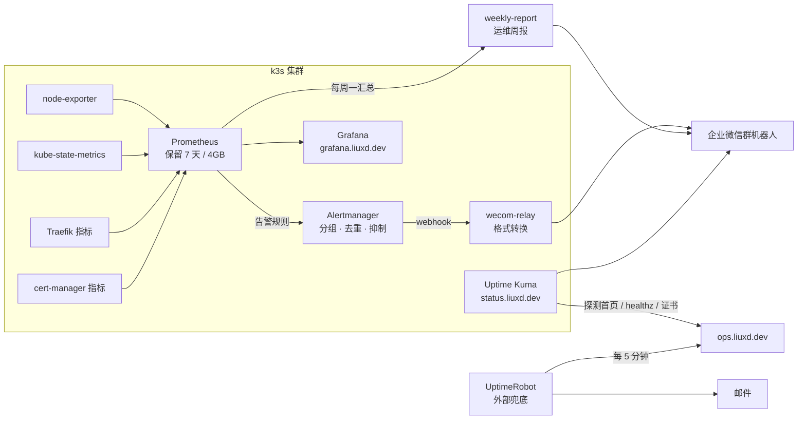

# 架构说明

## 总览

```mermaid
flowchart LR
  dev[开发者] -- git push --> gh[GitHub 仓库<br/>私有]
  gh --> ci[GitHub Actions<br/>检查 · 测试 · 构建]
  ci -- 镜像 :commit-sha --> ghcr[(GHCR<br/>公开镜像)]
  ci -- 提交新镜像标签<br/>[skip ci] --> gh

  subgraph server[LocVPS 香港 4C12G · Ubuntu 24.04 · 只开放 22/80/443]
    argo[Argo CD]
    traefik[Traefik<br/>:80 / :443]
    cm[cert-manager]
    subgraph ns[命名空间 ops-desk]
      svc[Service] --> p1[Pod nginx]
      svc --> p2[Pod nginx]
    end
    traefik -- Ingress --> svc
    argo -- 同步 · selfHeal --> ns
    helm[k3s helm-controller]
    argo -- 同步 HelmChart --> helm
    helm -- 安装 · 升级 --> cm
    helm -- 安装 · 升级<br/>监控、Argo CD 自己 --> argo
  end

  argo -- 每 60 秒拉取<br/>只读部署密钥 --> gh
  ghcr -- 拉取镜像 --> p1
  ci -. 轮询 /version.txt 确认上线 .-> traefik
  user[浏览器] -- https://ops.liuxd.dev --> traefik
  cm -- HTTP-01 --> le[Let's Encrypt]
  dns[Cloudflare DNS<br/>仅 DNS] -.-> traefik
```

## 请求路径

浏览器 → Cloudflare DNS（只做解析，不走代理）→ 服务器 443 → Traefik（终止 TLS，HTTP 跳转 HTTPS）→ Service → 两个 nginx Pod 之一。

## 技术选型与理由

| 选择                                          | 理由                                                                                                                                            | 放弃的方案                                                                                                                  |
| --------------------------------------------- | ----------------------------------------------------------------------------------------------------------------------------------------------- | --------------------------------------------------------------------------------------------------------------------------- |
| **Astro 静态输出**                            | 内容型站点，构建期生成 HTML，运行时零后端，攻击面最小                                                                                           | Next.js 等 SSR 框架：需要 Node 运行时，第一版用不到                                                                         |
| **nginx-unprivileged 镜像**                   | 默认以 uid 101 运行、监听 8080，配合只读根文件系统                                                                                              | 官方 nginx 镜像：默认 root 运行                                                                                             |
| **k3s 单节点**                                | 一个二进制装好 K8s，自带 Traefik、ServiceLB、local-path，8G 内存够用；API 与标准 K8s 一致                                                       | kubeadm：组件多、内存占用高；纯 Docker Compose：达不到练习 K8s 的目的                                                       |
| **Traefik（k3s 自带）**                       | 免安装，支持标准 Ingress 和 Middleware CRD                                                                                                      | ingress-nginx：需额外安装，且已进入维护末期                                                                                 |
| **cert-manager + HTTP-01**                    | 自动签发、自动续期；HTTP-01 不需要 DNS API 凭据                                                                                                 | DNS-01：需要 Cloudflare Token，通配符证书时再用                                                                             |
| **Kustomize**                                 | kubectl 内置，base + overlay 足够；清单是纯 YAML，便于审查                                                                                      | Helm：模板化对单个应用过重                                                                                                  |
| **GHCR 公开镜像**                             | 镜像只含公开的静态页面；免拉取凭证，换服务器不用重建 Secret                                                                                     | 私有镜像 + imagePullSecret：凭证只存在集群里，影响可重建性                                                                  |
| **镜像标签用 commit SHA**                     | 每个线上版本都能对应到一次提交，回滚目标明确                                                                                                    | `latest`：无法判断线上是哪个版本，也无法可靠回滚                                                                            |
| **Argo CD 拉取式 GitOps**                     | 集群从 Git 拉取，CI 不持有集群凭据，6443 不对公网开放；线上状态以 Git 为准，手动改动会被 selfHeal 纠正，回滚就是 git revert                     | 里程碑 0～3 的 CI 推送式（kubectl apply）：需要开放 6443，CI 持有集群凭据                                                   |
| **镜像标签提交回同一个仓库**                  | 单人项目少管一个仓库和一份凭据；CI 的标签提交带 `[skip ci]` 避免循环触发                                                                        | 单独的 GitOps 仓库：职责更清晰，适合多人、多环境，但要多维护一份写权限凭据                                                  |
| **基础组件也由 Argo CD 管理**（2026-10-13）   | Argo CD 同步 k3s 的 HelmChart 资源，实际安装和升级仍由 k3s 自带的 helm-controller 完成：不用迁移现有的 Helm release，服务器上不再手动放任何清单 | Argo CD 直接渲染 Helm chart：要接管现有 release，kube-prometheus-stack 的大型 CRD 还需要 ServerSideApply，迁移风险更高      |
| **用 /version.txt 确认上线**                  | 构建时写入 commit SHA，CI 从外部访问，看到新 SHA 才算上线：验证的是用户实际访问到的版本，且不需要集群权限                                       | `kubectl rollout status`：需要集群凭据，只能说明集群内部就绪                                                                |
| **自建 GoatCounter 统计访问**（2026-10-18）   | 单个程序加 SQLite，约 30MB 内存；不用 Cookie、不保存 IP；自带公开计数接口，首页直接显示访客数；数据留在自己的服务器上                           | Umami：要 PostgreSQL，内存大一个数量级；Plausible：要 ClickHouse；百度统计、Google Analytics：数据交给第三方，还要放 Cookie |
| **Traefik 改为 externalTrafficPolicy: Local** | k3s 的 ServiceLB 默认做 SNAT，应用看到的访客 IP 全是 10.42.0.1；单节点上改成 Local 没有副作用，访问统计和云盘登录记录都能拿到真实 IP            | 用 PROXY protocol 传 IP：需要前面再有一层负载均衡，单机用不上                                                               |

## 安全设计

| 层面        | 措施                                                                                                                                                     |
| ----------- | -------------------------------------------------------------------------------------------------------------------------------------------------------- |
| 服务器      | SSH 仅密钥登录；fail2ban；自动安全更新；防火墙在云安全组（白名单）                                                                                       |
| 集群        | Secret 静态加密（`secrets-encryption`）；kubeconfig 仅 root 可读                                                                                         |
| 工作负载    | 非 root（uid 101）、只读根文件系统、去掉全部 capabilities、禁止提权、seccomp RuntimeDefault、不挂载 ServiceAccount token；所有容器设置 requests / limits |
| CI / GitOps | CI 不持有任何集群凭据，6443 不对公网开放；Argo CD 用只读、只限本仓库的部署密钥拉取；Argo CD 界面强密码登录、禁止 exec                                    |
| 供应链      | 依赖由 lockfile 锁定；pnpm 拒绝发布不满 24 小时的新版本；基础镜像、k3s、cert-manager、Actions 全部固定版本                                               |
| 响应头      | HSTS、X-Content-Type-Options、X-Frame-Options、Referrer-Policy、Permissions-Policy                                                                       |

## 可用性设计

- 2 副本 + `maxUnavailable: 0`：滚动更新时先起新 Pod、就绪后再停旧 Pod。
- 就绪探针（`/healthz`）：新版本不健康时不接收流量，旧版本继续服务。
- `preStop` 等待 5 秒：Pod 删除时先让 Traefik 把它摘出转发名单，再退出，避免滚动更新时出现 504。
- 新版本不健康时 rollout 停住，旧版本继续服务；CI 通过 `/version.txt` 确认上线，失败时用 git revert 回滚（约 1 分钟）。
- 已验证：删除一个 Pod 期间连续请求全部 200；滚动重启期间 592 个请求全部 200；提交构建失败的改动，线上版本不变；手动改副本数，Argo CD 同一秒纠正；git revert 回滚 89 秒生效。

## 粘贴分析的设计

把 `df`、`free`、`kubectl get pods` 的输出或 nginx 日志粘贴进来，按固定规则标出问题，并链接到命令库里的下一步命令。

| 决定                                           | 理由                                                                                                                                                  |
| ---------------------------------------------- | ----------------------------------------------------------------------------------------------------------------------------------------------------- |
| 全部在浏览器里分析，不上传                     | 生产日志里有 IP、主机名和业务数据，很多公司禁止发给外部服务；纯前端也意味着可以在内网离线部署                                                         |
| 规则分析，而不是网站直接调用 AI                | 规则结果稳定、可测试；几万行日志的精确统计（5xx 占比、请求最多的 IP）AI 容易数错，日志太长还会被截断；站内调用 AI 需要后端保管 API key                |
| 可选「复制给 AI」：发统计摘要，不发原文        | 规则只认识写好的格式，复杂根因还是 AI 更强。摘要里只有统计、结论和最多 20 行关键原文，默认脱敏（同一个值对应同一个占位符），由用户自己决定发给哪个 AI |
| 每个解析器是纯函数，用真实格式的样例做单元测试 | 新增格式只需加一个解析器；样例同时用于页面的「载入示例」                                                                                              |

验收时用浏览器自动化监听了网络请求：载入示例、分析、生成摘要的全过程中，浏览器发出的请求数为 0。

## 监控告警的设计



| 决定                                                              | 理由                                                                                                                                                                                                     |
| ----------------------------------------------------------------- | -------------------------------------------------------------------------------------------------------------------------------------------------------------------------------------------------------- |
| kube-prometheus-stack，用 k3s 的 HelmChart 安装                   | 一套装齐 Prometheus、Alertmanager、Grafana 和常用规则；HelmChart 由 Argo CD 从 Git 同步（`deploy/platform/`），改配置提交即可                                                                            |
| 关闭 etcd、scheduler、controller-manager、kube-proxy 的采集和规则 | k3s 把它们合在一个进程里，没有单独的指标端口，不关会一直误报                                                                                                                                             |
| 自己写 Alertmanager → 企业微信的转发器                            | Alertmanager 只支持「企业微信应用」（要可信 IP，可信 IP 要求备案域名），不支持群机器人；现成的转发镜像来源不明。转发器约 150 行、零依赖、有单元测试，用官方 Node 镜像加 ConfigMap 运行，不用另外构建镜像 |
| Grafana 不做持久化                                                | 数据源和仪表盘都由代码预置（`deploy/monitoring/dashboards/`），重建后完全一致                                                                                                                            |
| 内部指标 + Uptime Kuma + UptimeRobot 三层                         | 内部指标看原因；Uptime Kuma 从用户视角看可用性和证书；Kuma 和站点在同一台机器上，整机宕机时由外部的 UptimeRobot 兜底                                                                                     |
| info 级别不发通知                                                 | 避免 CPUThrottlingHigh 这类提示信息刷屏，只在 Grafana 里看                                                                                                                                               |
| 关掉和自定义规则重复的默认告警，名字不同的同类告警用抑制规则去重  | 同一个问题只收到一条中文告警；默认规则只保留自定义规则没有覆盖的部分（如按趋势预测磁盘写满）                                                                                                             |
| 站点 5xx 和响应时间告警加最低请求量条件                           | 访问量小，一两个请求出错就会让比例跳到很高；没有流量时也不会因为算不出比例而误报                                                                                                                         |

### 评估过但没有部署的组件

| 组件                | 结论                 | 理由                                                                                                                                                 |
| ------------------- | -------------------- | ---------------------------------------------------------------------------------------------------------------------------------------------------- |
| **Rancher**         | 不部署               | 价值在多集群的生命周期管理（创建、升级、导入集群，统一权限）；单集群用不上，自身还要占 1～2GB 内存。应用交付已由 Argo CD 负责                        |
| **Longhorn**        | 不部署               | 价值在跨节点多副本；单节点没有副本可言，比 local-path 只多开销。数据安全靠 restic 备份到 R2；分布式存储放到 pve-lab 用 Ceph 练                       |
| **k9s / Headlamp**  | 暂不装，需要时选 k9s | Argo CD 界面 + kubectl 已够日常使用。k9s 装在服务器上、不进集群、不开公网入口，Termius 里也能用；Headlamp 是网页界面，要多管一个域名、证书和登录鉴权 |
| **Grafana 代替 UI** | 不能代替             | Grafana 只负责「看」（指标、告警）；扩缩容、改 YAML、重启、进容器这些「操作」要靠 Argo CD 界面或 kubectl                                             |

- **Rancher 和 Argo CD 不是二选一**：Rancher 管集群本身，Argo CD 管集群里的应用。Argo CD 同样支持多集群（ApplicationSet 批量分发）；企业多集群的常见组合是 Rancher 管集群，Argo CD 或 Fleet 管应用。
- **Argo CD 界面的盲区**：`platform` 应用里只看得到 HelmChart 资源本身，helm-controller 实际装出来的 cert-manager、kube-prometheus-stack、Argo CD 的 Pod 不在资源树里；k3s 自带的 Traefik、CoreDNS 也不在其中；进容器 Shell 默认关闭；Argo CD 自己故障时只能用 kubectl 排查。

## 已知局限

- Uptime Kuma 的监控项和 Alertmanager 的静默规则只存在集群里（Kuma 在 1Gi 卷上，静默在内存里），重建后需要按 runbook 手动配置一遍；监控项只有两个，几分钟就能配好。
- Grafana 界面上手动做的修改，Pod 重启后会丢失；正式的仪表盘要导出 JSON 放进仓库。
- 单节点：服务器整体故障时站点不可用。靠「一小时内按 runbook 重建」应对，见 `runbook.md` 第 3 节。
- 「镜像标签提交回同一个仓库」会在 main 上留下 CI 的 deploy 提交；快速回滚时必须记得带 `[skip ci]`，否则会被 CI 覆盖（见 runbook 第 2 节）。
- Argo CD 界面开放在公网，安全依赖强密码和及时升级。
- 首页的访客数由 GoatCounter 缓存，最多晚 4 小时更新；拦截统计脚本的访客（广告拦截插件）不会被计入。
- 单节点上没有设置 PodDisruptionBudget：节点排空时两个副本无处可迁，PDB 反而会让排空卡住。
